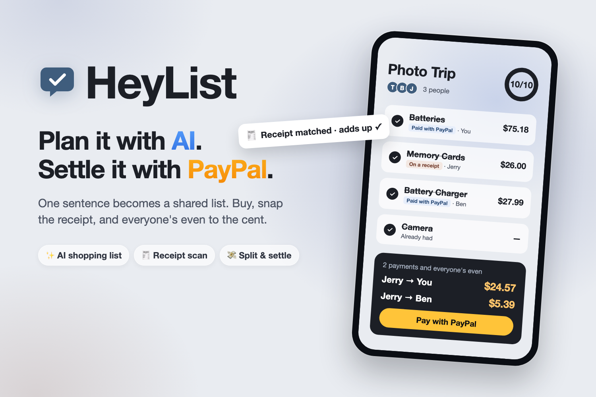

# HeyList

**Plan it with AI. Settle it with PayPal.**



Group trips are fun; the money isn't. 82% of people on group trips would rather overpay than argue about money (Harris Poll for CIT Bank, May 2026). HeyList turns one sentence into a shared shopping list, buys with PayPal, reads receipts with AI, and settles everyone up to the cent. It's a mobile-first website: no install, no account.

- **AI writes the list:** type or say "photo trip this weekend for 3 people" and get the items, quantities and prices from real stores.
- **Share by link:** friends join with just a name; the list updates on every phone live.
- **Buy with PayPal:** pay once with PayPal, Venmo or Pay in 4, or let the AI shopping assistant fill a cart within budget. An item is checked off only when PayPal's capture is `COMPLETED`.
- **Snap a receipt:** AI matches every line to the list and checks it adds up to the receipt's total.
- **Settle up:** code works out who owes whom, AI writes a friendly reminder, and PayPal sends the money straight to the person owed.

Built for the [PayPal AI Hackathon](https://paypalaihackathon.devpost.com/) · [MIT License](LICENSE)

## Try it (judges)

**Live demo:** https://heylist-web.onrender.com. PayPal **sandbox**: no real money moves.

PayPal sandbox buyer (log in on PayPal's page when paying):

| Email | Password |
|---|---|
| `sb-jl0nu53301040@personal.example.com` | `Y_362mfv` |

1. **Make a list:** on the home page, type or say one sentence, such as *"Weekend camping trip for 3 friends, $150 budget"*, and tap **Make my list**. Mark anything you own as **Already have**, then **Create list**.
2. **Add a second person:** open the list's link in a second browser or a private window and join under another name.
3. **Pay with PayPal:** as the first person, claim a few items, tap **Pay for items with PayPal** and approve with the sandbox buyer. The items are checked off with the payment as proof.
4. **Let the AI shop:** **More → Shop this list for me** on non-food items (a tent, batteries) proposes real store products within budget; approve one PayPal payment.
5. **Scan a receipt:** as the second person, tap **Take a photo** and photograph any store receipt, then **Confirm**. (Or tick an item by hand and type its price.)
6. **Settle up:** see who owes whom, tap **Remind** for an AI-written message, or **Pay with PayPal** to pay the person owed directly.

The AI's list and store prices vary a little between runs. Food is priced from Kroger, so use the shopping assistant on gear.

## Tools

| | Tool | What it does in HeyList |
|---|---|---|
| **PayPal** | Orders API v2 | Checkout built from server-side prices with per-item tax; capture status is the proof of payment; settle-up orders pay the friend who is owed |
| | Payments API v2 | Automatic refunds when two people buy the same item |
| | JS SDK v6 | PayPal, Venmo and Pay Later buttons with PayPal's Pay Later messages |
| | Webhooks | Signature-verified capture events finish pending payments |
| | Python Server SDK (APIMatic) | Every server call to PayPal, with idempotency keys |
| **AI** | Ollama `gemma4:31b` (vision) | Writes lists, checks store matches, matches receipt lines, tells a receipt from an item photo, drafts reminders |
| | AWS Textract | Reads receipts (`AnalyzeExpense`) and handwritten lists (`DetectDocumentText`) |
| | Web Speech API | Say the list instead of typing it |
| **Sponsors** | Channel3 | Real products and prices for the shopping assistant and Find in stores |
| | Render | Hosts the web app and API, plus a cron job that re-checks pending PayPal payments every 15 minutes |
| | APIMatic Context Plugins | SDK guidance while building |
| **Data** | Kroger Products API | Today's grocery prices at a real store |
| | Supabase | Postgres, receipt storage, auth, live updates |

Stack: Next.js 16 (React 19) → FastAPI (Python 3.14) → Supabase, deployed on Render from [`render.yaml`](render.yaml). **The AI proposes, code decides:** budgets, tax and the split are plain code, and a person confirms every AI suggestion. **Measured:** starting lists find 96/98 expected items with 0 invented (30 test cases); on 189 real English receipts, Textract shows a wrong price on 2.5% of lines ([docs/RECEIPT_EVAL.md](docs/RECEIPT_EVAL.md)).

## Run locally

Requires Node.js 24 and Python 3.14. Fill in `.env.local` (PayPal sandbox, Ollama and Supabase are required; Textract, Channel3 and Kroger are optional) and apply [`supabase/schema.sql`](supabase/schema.sql) to your Supabase project.

```bash
cp .env.example .env.local
npm install && npm run dev                                   # frontend, http://localhost:3000

python3 -m venv ../.venv && ../.venv/bin/pip install -r backend/requirements.txt
cd backend && ../../.venv/bin/uvicorn main:app --port 8000 --env-file ../.env.local   # backend
```

Tests: `../../.venv/bin/python -m unittest` from `backend/` (every external API mocked) and `npm run lint`.

More: [Architecture](docs/ARCHITECTURE.md) · [PayPal integration](docs/PayPal.md) · [Decisions](docs/DECISIONS.md) · [Spec](docs/SPEC.md)
